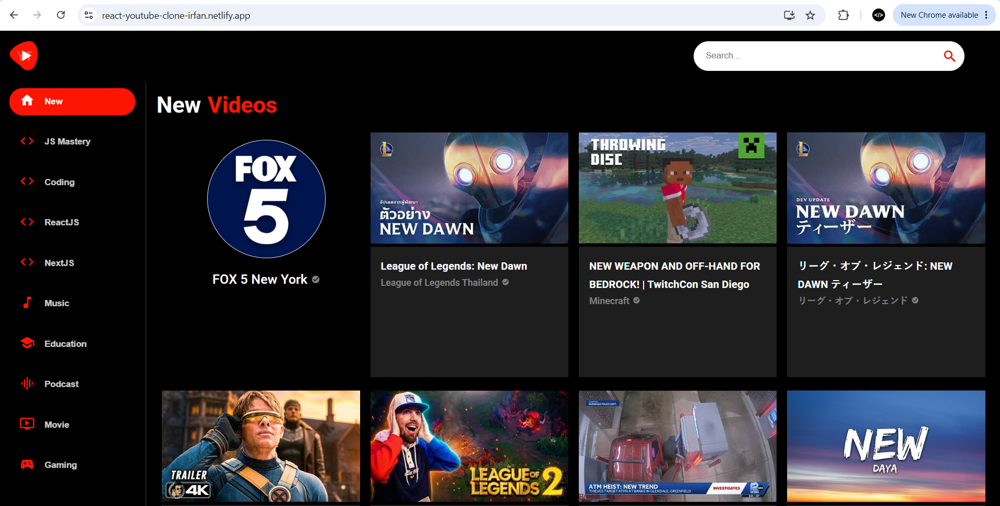
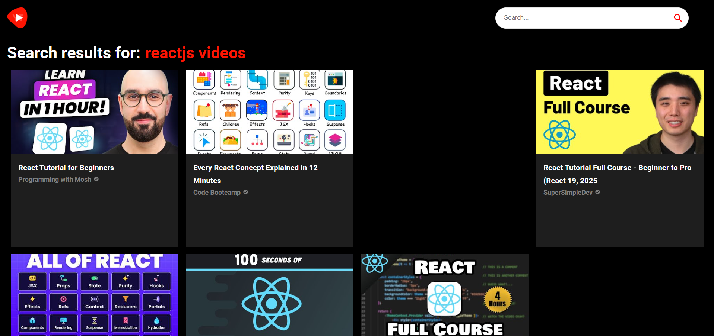

# React YouTube Clone

A YouTube-inspired video browsing application built with **React.js**, **Vite**, and the YouTube API through RapidAPI. Explore videos, browse categories, search for content, watch videos, and navigate through channel pages.

## 🚀 Live Demo

[View Live Application](https://react-youtube-clone-irfan.netlify.app/)

## 📸 Screenshots

### Homepage


### Search Results


## ✨ Features

- Browse videos across different categories.
- Search for videos by keywords.
- Explore categories such as ReactJS, NextJS, JavaScript, Coding, Music, Education, and more.
- View video thumbnails, titles, channel names, and other details.
- Watch videos using the integrated video player.
- View detailed video information and suggested videos.
- Navigate to channel pages and explore channel videos.
- Interactive sidebar navigation.
- Responsive user interface.

## 🛠️ Technologies Used

- **React.js** – Component-based UI development.
- **Vite** – Development server and build tool.
- **JavaScript (ES6+)** – Application logic.
- **Material UI** – UI components and icons.
- **React Router DOM** – Client-side routing.
- **React Player** – Video playback.
- **Axios** – API requests.
- **YouTube API via RapidAPI** – Video and channel data.
- **HTML5 & CSS3** – Structure and styling.

## ⚙️ Getting Started

Follow these steps to run the project locally.

### 1. Clone the repository

```bash
git clone https://github.com/Irfanft12/react-youtube-clone.git
```

### 2. Navigate to the project directory

```bash
cd react-youtube-clone
```

### 3. Install dependencies

```bash
npm install
```

### 4. Configure environment variables

Create a `.env` file in the project root and add your RapidAPI key:

```env
VITE_RAPID_API_KEY=your_rapidapi_key
```

Replace `your_rapidapi_key` with your own RapidAPI key.

**Important:** Never commit your `.env` file or expose your API credentials in public repositories.

### 5. Start the development server

```bash
npm run dev
```

Open the local URL shown in your terminal. By default, Vite uses:

```text
http://localhost:5173
```

### 6. Create a production build

```bash
npm run build
```

The production-ready files will be generated in the `dist` directory.

To preview the production build locally:

```bash
npm run preview
```

## 🌐 Deployment

The application is deployed using [Netlify](https://www.netlify.com/).

[Visit the Live Application](https://react-youtube-clone-irfan.netlify.app/)

## 🔐 Security Note

Vite exposes environment variables prefixed with `VITE_` in the client-side application bundle. Therefore, API keys used directly in frontend requests are not secret.

For production applications, consider routing API requests through a secure backend or serverless function to protect API credentials.

## 👨‍💻 Author

**Irfan Ahmad**

Senior Front-End Developer | HTML | CSS | JavaScript | jQuery | React.js

- [GitHub](https://github.com/Irfanft12)
- [LinkedIn](https://www.linkedin.com/in/irfan-ahmad-dev-mumbai/)
- [Portfolio](https://irfan-ahmad-portfolio.netlify.app/)

---

*Built as a hands-on project to explore React.js, API integration, component-based architecture, and modern frontend development.*